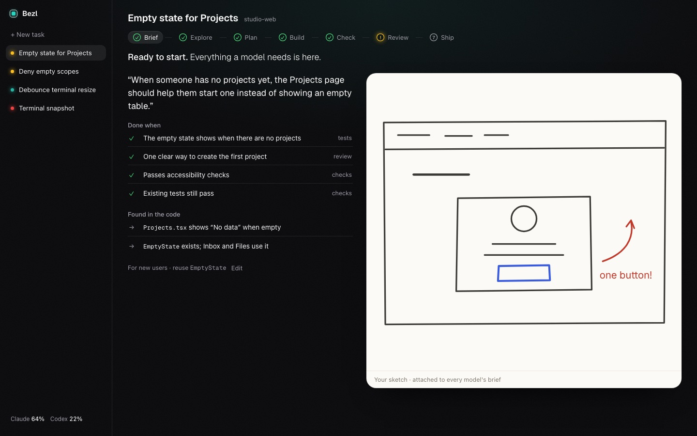
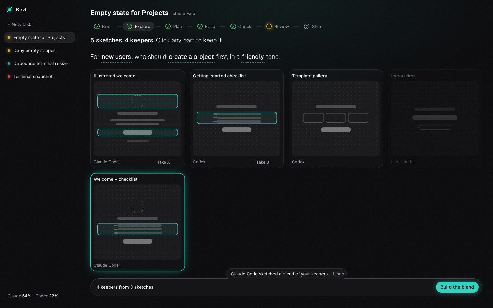
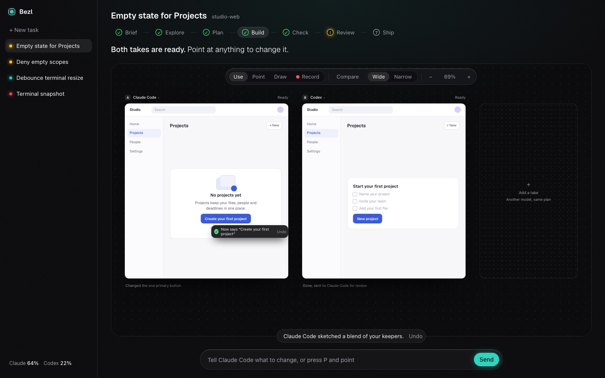
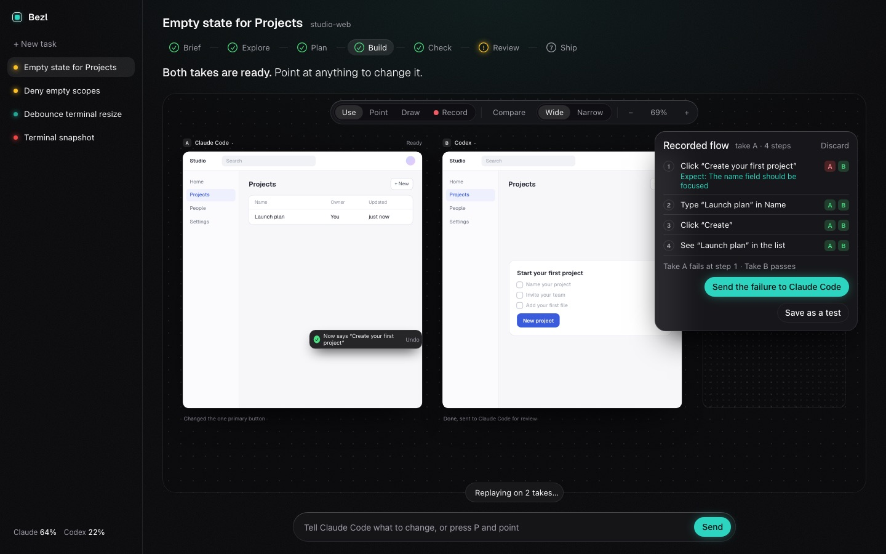
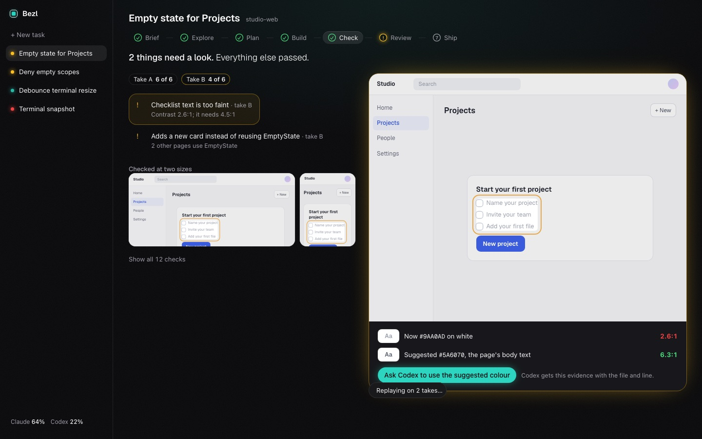
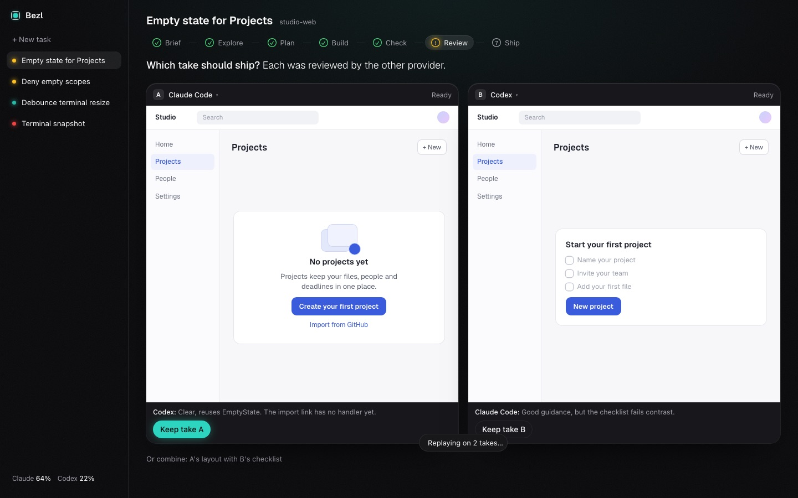
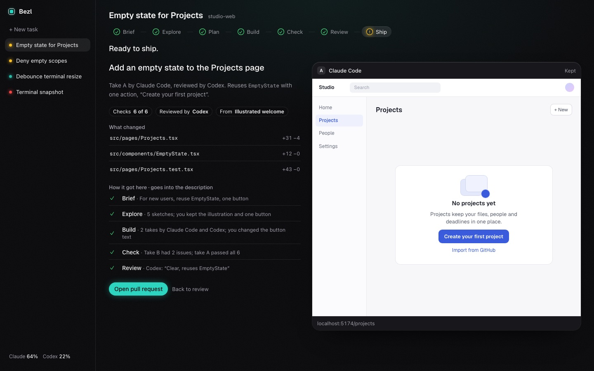

# Product vision: the task journey

What Bezl is for, how the app is shaped around one task's journey, and how that maps onto the [roadmap](roadmap.md). The interactive sketch is in [`sketches/journey`](sketches/journey/README.md); it uses sample data and is not wired to the domain.

## Why someone would use Bezl instead of Claude Code or Codex alone

1. **A second opinion from another company's model, automatically.** Every agent's built-in review comes from the vendor that wrote the code ([research](research/agent-ui-baseline.md)). Bezl pairs a writer with a reviewer from a different provider, and the reviewer is blocked from writing (spike 3).
2. **Bezl checks the work itself.** An agent says "tests pass"; Bezl runs the checks in the worktree and believes only the result.
3. **The task is not tied to one model.** You choose which model writes, which reviews and which local model sorts first. You can switch between steps. When one hits its usage limit or fails, the next takes over from the same task record. A chat ends with its session; a Bezl task does not.
4. **Context you can read, which the models share.** Bezl keeps a map of the code, so it can say in plain words what a change touches. Every model gets the same small brief with pointers to the code, and you can read it too.
5. **One place, one record.** Questions from several tools land in one list. What was asked, who did what, what passed and what you decided are saved in the repository.

Reasons 3 and 4 come from building Bezl itself: work stalled when one tool hit its usage limit, and context was lost when a long session was compacted.

## The one job

Get a change you can trust, spending your attention only where it is needed. Every task screen answers: what did I ask for, where does it stand, what needs me, what changed and what it touches, and who is working on it on which model.

## The journey

A task moves through seven stages: **Brief, Explore, Plan, Build, Check, Review, Ship**. Tasks that change no UI skip Explore. The stage strip at the top of the task is the app's spine: each stage shows a status light, and you click a stage to see it.

| Stage | What it shows | What you can do |
|---|---|---|
| Brief | Your words, the "done when" list (each item says who checks it), what the code map found, your sketch | Edit the brief; answer what Bezl asks |
| Explore | Sketches of several design directions, built from the project's own components | Answer the questions that shape the design, keep parts of any sketch, drop directions, blend keepers, build any direction as a take |
| Plan | One plan per take, with steps lighting up as they finish | Edit a plan; the take's writer adjusts from its next step |
| Build | The preview canvas: every take running live | Use, point, draw, record and compare (below); switch a take's model; steer the writer |
| Check | Problems first, with evidence on the page; everything else behind "Show all" | Send a failing check to the take's writer |
| Review | Each take, reviewed by a model from the other provider | Keep a take, or combine parts of two |
| Ship | The pull request beside the kept result, with how it got here | Open it |

### Setting the task up to succeed

Most agent tools start writing code from the first sentence. Bezl puts two cheap steps first, because the expensive mistake is building the wrong thing well.

- **A brief that is ready.** A new task's brief is checked as you type against five things: what you want, who it is for, how you will know it is done, what to avoid or reuse, and a reference. Each missing item says why it matters and offers a one-click addition. Constraints come from the code ("Bezl found EmptyState in the code"). You can always start anyway.
- **Explore in sketches, not code.** A sentence sets the design's shape ("For new users, who should create a project first, in a friendly tone"), and changing a word offers to redraft. Several models sketch directions as structured wireframes that Bezl draws itself. You click any part of a sketch to keep it, and "Blend them" asks a model for a new direction from your keepers. Any direction can be built as a take. A local model can draft sketches for free.
- **The design follows through.** Check gains "Matches its direction" and "Design system", the latter flagging a take that adds a new component instead of reusing one. The pull request records which direction won.

### The preview canvas

Build is a canvas. Every take is an artboard on one board you can pan and zoom, at Wide or Narrow size, each running from its own worktree. One toolbar holds five ways to work, each with a key:

- **Use (U):** click and type in the running app.
- **Point (P):** click an element and say what to change. The take's writer gets the element's source file and line.
- **Draw (D):** drag a box around an area and describe it. The writer gets the region.
- **Record (R):** use the app while Bezl captures each click and entry as steps.
- **Compare:** a before/after slider against `main` on every artboard.

Recordings do work. A stopped recording is a flow you can annotate at any step ("The name field should be focused"), and each note becomes an expectation. "Replay on all takes" runs the flow on every artboard and marks each step per take. In the sketch, take A fails step 1 and take B passes, and the failure goes to take A's writer with the recording attached. "Save as a test" adds the flow to Bezl's checks.

### Check, Review and Ship

## Calm by default

Earlier drafts crowded every screen with side panels and footnotes. These rules keep the journey readable:

1. One focal thing per stage: the previews on Build, Review and Ship, the sketches on Explore, the problems on Check, your words on Brief.
2. One sentence of status under the stage strip. Help lives in tooltips, not footnotes.
3. No side panels. A take's model sits in its header and its activity is one line under it.
4. Controls appear where you use them, on hover or focus, and stay reachable from the keyboard.
5. Show problems, not passes.
6. The message box appears only on Build, where you steer.
7. Freed space goes to the work at full size, never to new panels.
8. Colour stays scarce: teal glows on what is working, amber on what waits for you, red on a failure. The product being built keeps its own colours.

Measured on the same task at 1440 by 900 against the earlier draft, counting only stage content, words per stage fell from 177 to 293 down to 65 to 114, and boxes from 2 to 7 down to 0 to 4. A screen that needs more than about 120 words or 3 boxes to explain itself should move something one level down.

## Look and feel

The sketch loads kbui 0.4.0 and the app theme from bezl #3: a near-black canvas with grain and a faint light from above, rounded surfaces with a lit top edge, and one accent. The theme points kbui's `--kb-color-accent` at `--kb-color-info`, so buttons, progress and live lights share one teal. Two kbui asks came out of this, both generic: an `attention` Panel tone (the sketch re-lights `active` in amber) and button colour tokens.

## Models and roles

You bind each role to a model, and Bezl refuses a crew that breaks the rules in the [Crew protocol](crew-protocol.md):

| Role | Default | Rule |
|---|---|---|
| Writes | Claude Code | Must be an agent CLI, because only those have tools |
| Reviews | Codex | Must come from a different provider than the writer, and be proven read-only |
| Sorts first | A local model through Ollama | Its findings count only once a reviewer or a test confirms them |
| Takes over | Codex | Used when a model fails or nears a limit |

On the canvas, a take's model is a menu in its header. A choice that breaks a rule is shown greyed out with the reason. Gemini CLI is not a default: Google stopped serving it on personal accounts on 18 June 2026, and the third provider is open (M3).

## Context you can read

The code map turns a change into a few sentences: what changed, who else calls it, and which tests run it. infigraph already covers the jobs listed under Code Facts in the Crew protocol (outlines, callers and impact, changed symbols against a base, text search). Its raw output still needs work before it reaches a screen. On bezl's own Task screen branch, `infigraph detect-changes` against the merge base reported 32 files and 363 "changed symbols", including local variables and markdown headings, and `infigraph callers layoutWorkerMap` returned nothing although `WorkerMap.tsx` uses it. So Bezl must reindex each worktree after every step, keep exported symbols only, import SCIP indexes for TypeScript, and say when it does not know. Using infigraph instead of the home-grown module is proposed, not decided; see the Crew protocol's open decisions.

## In your control

What Claude Code and Codex already let you do, extended across models. Not all of it is in the sketch; the column says which.

| You can | How | In the sketch |
|---|---|---|
| Steer while a model works, and stop it | The message box on Build, and Stop | Message box |
| Say exactly what to change | Point at an element or draw around an area | Yes |
| Check a flow on every take | Record, add an expectation, replay | Yes |
| Choose who writes each take | The model menu on each take | Yes |
| Choose when to be asked | One "Ask me before" setting, translated into each CLI's flags | No |
| Go back to any step | Rewind to the snapshot Bezl takes at the end of every step, shell edits included | No |
| Refer to code precisely | `@` for files and symbols from the code map | No |
| Watch limits | Each provider's usage in the sidebar, with handover before a limit | Usage line |

## How the journey maps onto the milestones

The journey is the app's shape from the first real task (M5) on. M1 to M4 build what it stands on. This pull request makes the matching edits to the [roadmap](roadmap.md) and `progress.json`.

| Stage | First real in | What the user gets then | Grows in |
|---|---|---|---|
| Task list | M2 (data), M5 (screen) | Tasks with a status light; amber means it needs you | M3: the usage line |
| Brief | M5 | Your words, the done-when list, the readiness check | M6: "Found in the code" from the code map |
| Explore | M6 | Shaping sentence, sketches from the local model lane, keepers, blend | M8: several providers' sketches, direction checks |
| Plan | M5 | One editable plan | M6: one plan per take |
| Build | M5 | One take: live terminal line, Stop, the message box | M6: more takes, model switching, handover. M7: the preview canvas |
| Check | M5 | Problems first from Bezl's own build, tests and lint | M7: accessibility and visual checks at two sizes, recordings as tests |
| Review | M5 | The other provider's verdict; keep or send back | M1 decides whether findings go to the writer automatically. M6: several takes |
| Ship | M5 | Pull request with how it got here | M7: the kept take's preview |
| Model menus, usage | M3 | Menus offer only what passed preflight | M6: handover before limits |

What each milestone means for the UI:

- **M0.** kbui 0.4.0 and the app theme carry straight into the journey. The worker-map Task screen in #3 is replaced by the journey in M5; #1 and #3 still bring the theme, the kbui adoption and their tests.
- **M1.** Decides how much is automatic. If the crew test passes, Review sends typed findings to the writer and parallel takes are worth running. If it fails, every stage stays with one take, and "Ask Codex to fix it" becomes "Write to Claude Code" with the finding quoted for you to send.
- **M2.** Every stage is a reading of the task's event log. Each take is a worktree with its own writer lease, and keepers, pins, recordings and decisions are events.
- **M3.** Fills the model menus and the usage line, and proves reviewers are read-only.
- **M4.** The live line under each take, its full terminal, Stop, and the message box writing into the worker's input.
- **M5.** The journey with one take, end to end. Its pass mark is unchanged.
- **M6.** Several takes, model switching, handover before limits, the local model lane (which also drafts Explore sketches), and the code map behind "Found in the code" and every brief.
- **M7, new: the preview canvas.** The baseline for interactive previews: a preview runner per worktree, the five canvas modes, recordings with expectations, replay and saved tests, and accessibility and visual checks at two sizes. Later, each as its own small milestone: app states (empty, many, loading, error) side by side, live design-token tweaks, device and theme presets, shared annotations, and recordings as video.
- **M8, new: Explore with several models.** Sketches from several providers, blending, the direction board in every brief, and the direction and design-system checks.

After those, only if users ask: suggested crews from your own results (after about 30 tasks), cheap-first cascades with cost per task, tasks across several repositories, and project memory offered to the next task that touches the same code.

## Open decisions this depends on

- **Passing findings between providers.** The README rule forbids relaying one provider's output to another; the crew test needs typed, logged findings to reach the writer. M1 settles it.
- **infigraph for Code Facts**, instead of the home-grown module, after a licence and packaging check.
- **The third provider** (M3).
- **Isolated worker configs** (M1), which change the token numbers shown on screen.
- **Usage limits.** Preflight has to establish what each CLI reports. Where a CLI reports nothing, the usage line says "unknown".
- **Element-to-source mapping and anchored annotations** (M7). In the sketch, marks are pinned to pixels and stay put when a take is switched to Narrow; the real canvas anchors them to elements.
